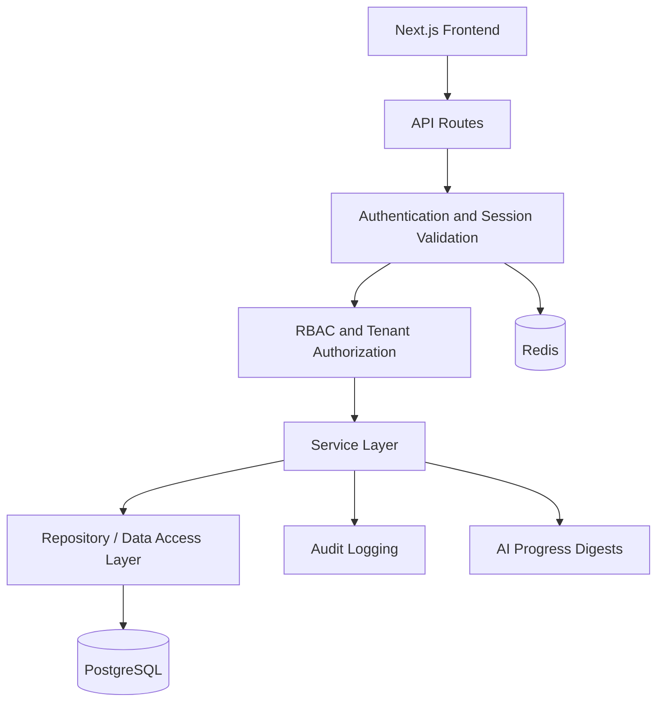

# Nexus Ops — Secure Multi-Tenant Collaboration Platform

**One identity. Multiple organizations. Secure collaboration.**

Nexus Ops is a multi-tenant B2B collaboration platform that enables separate organizations to work together on support tickets and code reviews without exposing their private data. It combines role-based access control, tenant-scoped authorization, selective resource sharing, session revocation, and append-only audit logging in a unified workspace.

**Live Demo:** https://unified-workspace.vercel.app/  

## The Problem

When a company works with external vendors or contractors, collaboration often requires sharing access to internal tools. Broad access can expose confidential customer information, unrelated projects, and sensitive internal discussions. Using separate accounts and scattered communication channels creates additional friction.

Nexus Ops addresses this problem with a shared workspace where organizations can collaborate on explicitly authorized resources while keeping unrelated company data isolated.

## Key Features

### Multi-Organization Identity
- Sign in through a unified identity and switch between organizations from the workspace.
- Support different memberships and roles across organizations.
- Onboard new organizations through registration.

### Secure Support Hub
- Create, view, update, and manage support tickets.
- Track ticket status, comments, and attachments.
- Share selected tickets with approved partner organizations.

### Pull Request Review Workflow
- Manage pull requests and reviewer assignments.
- Support review decisions, approval workflows, and review history.
- Share specific pull requests with authorized partner organizations.

### Team Member Management
- Invite members into an existing organization.
- Assign permitted organization roles and manage member access.
- Accept invitations through a dedicated invitation flow.

### Selective Cross-Organization Collaboration
- Establish organization connections through an approval workflow.
- Share individual resources instead of granting unrestricted organization access.
- Restrict external users to resources explicitly shared with their organization.

### Security and Access Control
- **Five-role RBAC:** Apply role-specific permissions across the platform.
- **Tenant isolation:** Enforce organization-scoped access on protected resources.
- **BOLA prevention:** Prevent users from accessing another organization's private resources by manipulating resource IDs.
- **Session revocation:** Use Redis-backed session versioning to invalidate revoked sessions.
- **Append-only audit logging:** Record sensitive actions, including membership and resource changes.
- **Authentication security:** Include server-side validation, password hashing, and protected authentication flows.

### AI-Assisted Progress Digests
Generate progress summaries from relevant support tickets and pull-request activity to help users identify pending work and review requirements.

## Architecture

Nexus Ops follows a layered architecture that separates the user interface, API handling, authorization, business logic, and data access.



**Security principle:** Every protected operation must enforce authorization on the server. Hiding a button in the frontend is not a substitute for access control.

## Technology Stack

| Layer | Technologies |
|---|---|
| Frontend | Next.js, React, TypeScript |
| Backend | Next.js API Routes, Node.js |
| Authentication | NextAuth.js v5 |
| Database | PostgreSQL |
| ORM | Prisma |
| Session and caching infrastructure | Redis |
| Security | RBAC, tenant-scoped authorization, session versioning |
| Testing | Automated security and regression test suites |

## Getting Started

### Prerequisites

- Node.js version compatible with the project
- npm
- PostgreSQL database
- Redis instance
- Git

### 1. Clone the repository

```bash
git clone https://github.com/gargijoshi9/unified-workspace.git
cd unified-workspace
npm install
```

### 2. Configure environment variables

Create a local `.env` file using the variables required by the project:

```env
DATABASE_URL="your_postgresql_connection_string"
REDIS_URL="your_redis_connection_string"
AUTH_SECRET="your_secure_random_secret"
NEXTAUTH_SECRET="your_secure_random_secret"
NEXTAUTH_URL="http://localhost:3000"
```

Use the variable names expected by the current application configuration. Generate strong, unique secrets and never commit `.env` files or real credentials.

For email-based invitations and password recovery, configure the email provider required by the application before enabling those workflows for real users.

### 3. Prepare the database

Validate the Prisma schema:

```bash
npx prisma validate
```

Generate the Prisma Client:

```bash
npx prisma generate
```

Apply the appropriate database migrations using the project's existing migration workflow. Review `package.json` and the project setup documentation for any additional initialization or seed commands.

Never reset a database containing data you need to preserve.

### 4. Start the development server

```bash
npm run dev
```

Open [http://localhost:3000](http://localhost:3000).

### 5. Run tests and verify the production build

```bash
npm test
npx tsc --noEmit
npm run build
```

These commands check automated tests, TypeScript types, and production compilation. Runtime behavior and deployment configuration require separate verification.

## Role-Based Access Control

Nexus Ops supports five roles:

| Role | Primary responsibility |
|---|---|
| `PLATFORM_SUPER_ADMIN` | Platform-level administration |
| `ORG_ADMIN` | Organization management, members, settings, and resources |
| `SUPPORT_AGENT` | Support ticket operations |
| `REVIEWER_APPROVER` | Pull-request reviews and approval workflows |
| `CROSS_ORG_GUEST` | Restricted access to explicitly shared resources |

Actual permissions are enforced by the backend and depend on the operation and resource-sharing context. Cross-organization guests must not receive unrestricted access to the host organization's private data.

## Security Design

Nexus Ops is designed around the principle of least privilege.

- **Tenant-scoped data access:** Protected queries must be scoped to the authenticated user's authorized organization and sharing context.
- **Resource-level authorization:** Access to an individual ticket or pull request is checked independently of whether the user knows its ID.
- **Session invalidation:** Redis-backed session versioning supports revoking access across active sessions.
- **Auditable operations:** Sensitive mutations produce audit events intended to preserve accountability.
- **Invitation safeguards:** Invitation workflows use scoped permissions and token-based acceptance.

Security tests provide regression coverage for authorization boundaries, tenant isolation, authentication, session revocation, and audit behavior.

## Testing

The project includes automated tests covering areas such as:

- Cross-tenant resource isolation and unauthorized access.
- Role-based authorization.
- Authentication and session lifecycle.
- Token revocation.
- Audit logging.
- Organization membership and invitation workflows.

**Reported test coverage:** 10 test suites and 172 assertions. Run `npm test` to verify the current result before relying on this figure.

## Project Status and Limitations

Nexus Ops is an actively developed project. Its production readiness depends on runtime security verification and correct deployment configuration.

Before deploying for real organizational use, verify:

- Production database and Redis configuration.
- Email delivery for invitations and account recovery.
- Secure production secrets and cookie settings.
- Database migrations and backup procedures.
- Authorization tests against realistic tenant scenarios.
- Protection for scheduled jobs and administrative endpoints.
- Monitoring, error reporting, and operational recovery procedures.

Local demo accounts, if configured, are for development demonstrations only and must not be treated as production credentials.

## Future Improvements

- Continuous integration and automated deployment checks.
- Enhanced operational monitoring and security alerting.
- Expanded audit reporting and compliance-oriented exports.
- More comprehensive integration and end-to-end testing.

## Author

**Gargi Joshi**  
B.Tech in Information Technology, Pune Institute of Computer Technology

- [GitHub](https://github.com/gargijoshi9)
- [LinkedIn](https://linkedin.com/in/gargi-joshi)

---

*Built to make cross-company collaboration safer, more controlled, and more accountable.*