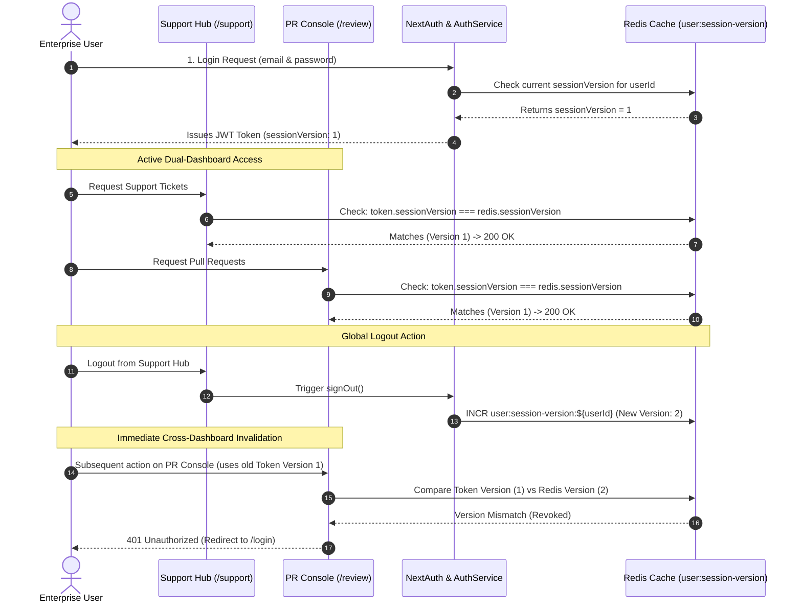
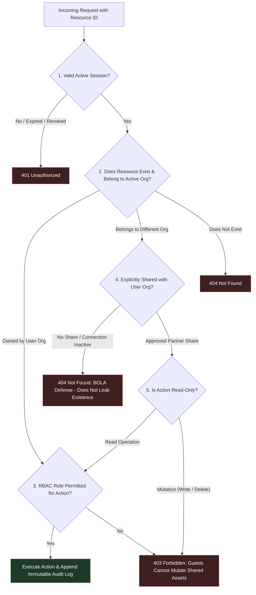

# System Architecture & Technical Specifications

This document outlines the architectural blueprints, data flow boundaries, security controls, and technical specifications for the **Unified Organization Workspace**.

---

## 1. High-Level System Architecture Diagram

```mermaid
flowchart TD
    User([User / Browser]) -->|HTTPS + NextAuth Cookie| Presentation

    subgraph Presentation [1. Next.js Frontend Layer (React 19)]
        SupportHub[Support Hub (/support)]
        ReviewConsole[PR Review Console (/review)]
        AuditView[Audit Trail (/review/audit)]
        AuthViews[Auth Views: /login, /register, /reset-password]
    end

    Presentation -->|HTTP REST / JSON| APIRoutes

    subgraph APIRoutes [2. Next.js API Routes]
        AuthRoutes["/api/auth/* (register, recovery, callback)"]
        TicketRoutes["/api/tickets/*"]
        PRRoutes["/api/prs/*"]
        AuditRoutes["/api/audit"]
        ConnRoutes["/api/connections/*"]
        FlagRoutes["/api/feature-flags"]
    end

    APIRoutes -->|Protected Scoped Execution| Middleware

    subgraph Middleware [3. Middleware & Security Enforcement Layer]
        RateLimiter["Redis Distributed Rate Limiter (checkRateLimit)"]
        WithAuth["Authentication Guard (withAuth / Session Revocation Check)"]
        WithTenant["Tenant Context Guard (withTenant / Org Scoping)"]
        WithPerm["RBAC & Policy Guard (withPermission / canPerform)"]
    end

    Middleware -->|Authorized Domain Calls| ServiceLayer

    subgraph ServiceLayer [4. Feature Service Layer (Business Logic & Policy)]
        AuthService[AuthService: validateCredentials, register, tokenHash]
        TicketsService[TicketsService: BOLA checks, ticket lifecycle, comments]
        PRsService[PRsService: N-approval rules, reviewers, revisions]
        OrgService[OrganizationService: mutual connection approvals, flags]
        AuditService[AuditService: immutable event emission]
        AIService[AIService: multi-tenant digest summarization]
    end

    ServiceLayer -->|Clean Data Queries| Repositories

    subgraph Repositories [5. Repository Layer]
        TicketRepo[TicketRepository]
        PRRepo[PRRepository]
        OrgRepo[OrganizationRepository]
        AuditRepo[AuditRepository]
    end

    Repositories -->|Prisma Client (@prisma/adapter-pg)| Postgres[(PostgreSQL Database)]
    ServiceLayer -.->|Session Versioning & Hashes| Redis[(Upstash / Local Redis)]
    RateLimiter -.->|Atomic Increments| Redis

    subgraph Persistence [6. Persistence & Storage Layer]
        Postgres --- Models["User, Org, Membership, Ticket, PR, AuditLog, Digest"]
        Redis --- CacheKeys["user:session-version, ratelimit:*, password-reset:*"]
    end

    style Presentation fill:#1E222A,stroke:#61AFEF,color:#ABB2BF
    style APIRoutes fill:#1E222A,stroke:#98C379,color:#ABB2BF
    style Middleware fill:#2C313C,stroke:#E5C07B,color:#ABB2BF
    style ServiceLayer fill:#1E222A,stroke:#C678DD,color:#ABB2BF
    style Repositories fill:#1E222A,stroke:#56B6C2,color:#ABB2BF
    style Postgres fill:#181A1F,stroke:#E06C75,color:#ABB2BF
    style Redis fill:#181A1F,stroke:#D19A66,color:#ABB2BF
```

---

## 2. Session Synchronization & Global Revocation Sequence

This sequence illustrates how dual dashboards share a single session and how logging out from one dashboard instantly invalidates access across all other dashboards and devices via Redis versioning.



---

## 3. Multi-Tenant Authorization & BOLA Prevention Flow

Broken Object Level Authorization (BOLA) occurs when an application receives an object ID and fails to verify that the requesting user owns or is authorized to access that object. The diagram below illustrates how every request is strictly filtered:



---

## 4. Deep-Dive Security Controls

### A. Multi-Tenant Isolation & BOLA Defense
1. **Tenant-Scoped Repository Queries**: Domain repositories never execute unqualified `findUnique` operations without matching `orgId`. All records are scoped by `user.activeOrgId`.
2. **Existence-Masking 404 Responses**: When a user attempts to access or mutate a resource belonging to a different organization, the server responds with **`404 Not Found`** instead of `403 Forbidden`. This critical defense prevents attackers from discovering valid IDs belonging to other companies.
3. **Cross-Organization Shared Boundaries**:
   * Two organizations must establish an explicit `OrgConnection` in `APPROVED` status.
   * Specific resources are shared via `TicketShare` or `PRShare` records.
   * Cross-org users are restricted to read and comment actions; mutation and deletion are blocked.

### B. Role-Based Access Control (RBAC) Matrix
The system defines 5 roles (`Role` enum in Prisma):

| Permission / Action | `PLATFORM_SUPER_ADMIN` | `ORG_ADMIN` | `SUPPORT_AGENT` | `REVIEWER_APPROVER` | `CROSS_ORG_GUEST` |
| :--- | :---: | :---: | :---: | :---: | :---: |
| **Create Support Ticket** | ✅ | ✅ | ✅ | ❌ | ❌ |
| **Read Own Org Tickets** | ✅ | ✅ | ✅ | ✅ | ❌ |
| **Read Shared Partner Tickets** | ✅ | ✅ | ✅ | ✅ | ✅ (Shared only) |
| **Update Own Org Ticket** | ✅ | ✅ | ✅ | ❌ | ❌ |
| **Delete Own Org Ticket** | ✅ | ✅ | ❌ | ❌ | ❌ |
| **Create Pull Request** | ✅ | ✅ | ❌ | ❌ | ❌ |
| **Read Own Org PRs** | ✅ | ✅ | ❌ | ✅ | ❌ |
| **Review / Approve PR** | ✅ | ❌ (Unassigned) | ❌ | ✅ (Assigned) | ❌ |
| **Merge Pull Request** | ✅ | ✅ | ❌ | ❌ | ❌ |
| **Manage Feature Flags** | ✅ | ✅ | ❌ | ❌ | ❌ |
| **View Audit Trail** | ✅ (Global) | ✅ (Org only) | ❌ | ✅ (Org only) | ❌ |
| **Manage Partner Connections** | ✅ | ✅ | ❌ | ❌ | ❌ |

### C. Redis-Backed Real-Time Session Invalidation
* In typical JWT architectures, revoking a token before its natural expiry requires database lookups on every request or waiting for the token to expire.
* We solve this by storing a lightweight integer version key in Redis: `user:session-version:${userId}`.
* When a user logs in, their JWT is issued with `token.sessionVersion = currentVersion`.
* When a user clicks **Sign Out** or changes their password, `handleSignOutEvent` performs an atomic `INCR` on `user:session-version:${userId}`.
* On every subsequent request, NextAuth's JWT callback validates that `token.sessionVersion === redisVersion`. If a mismatch is detected, the token is marked revoked and rejected immediately with `401 Unauthorized`.

### D. Append-Only Immutable Audit Trail
* Every sensitive action (ticket creation, status updates, PR review approvals, cross-org sharing, organization registrations, and password resets) creates an `AuditLog` record.
* The `AuditRepository` restricts queries to `create` and `findMany`.
* Explicit database constraints and service guards prevent any `UPDATE` or `DELETE` operations on audit logs, ensuring forensic integrity for security compliance.

---

## 5. Security Testing Architecture

The project maintains **9 automated security test suites** executed via `npm test`:

1. **`tests/auth-security.test.ts`**: Tests registration validation, password hashing, atomic transaction rollback, privilege escalation guards, email normalization, production session injection rejection, and recovery token lifecycle.
2. **`tests/tenant-isolation.test.ts`**: End-to-end verification of cross-tenant resource reads, updates, deletions, and reverse cross-tenant access. Confirms zero database state mutation on unauthorized access attempts.
3. **`tests/bola-tickets.ts`**: Verifies BOLA isolation on support tickets.
4. **`tests/bola-prs.ts`**: Verifies BOLA isolation on pull requests.
5. **`tests/bola-digests.ts`**: Verifies that AI progress digests dynamically aggregate only permitted tenant and shared items, never leaking private partner data.
6. **`tests/rbac.test.ts`**: Exhaustive 47-assertion matrix covering every role and permission combination.
7. **`tests/session-sync.test.ts`**: Verifies cross-dashboard session sharing and instant multi-device invalidation on logout.
8. **`tests/token-revocation.test.ts`**: Verifies that stolen or reused JWT tokens cannot access protected endpoints after logout.
9. **`tests/audit.test.ts`**: Verifies append-only immutability by asserting that attempts to update or delete audit records throw fatal restrictions.
